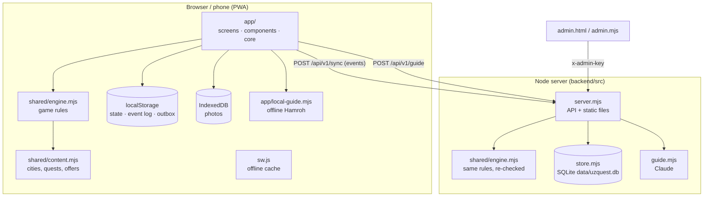
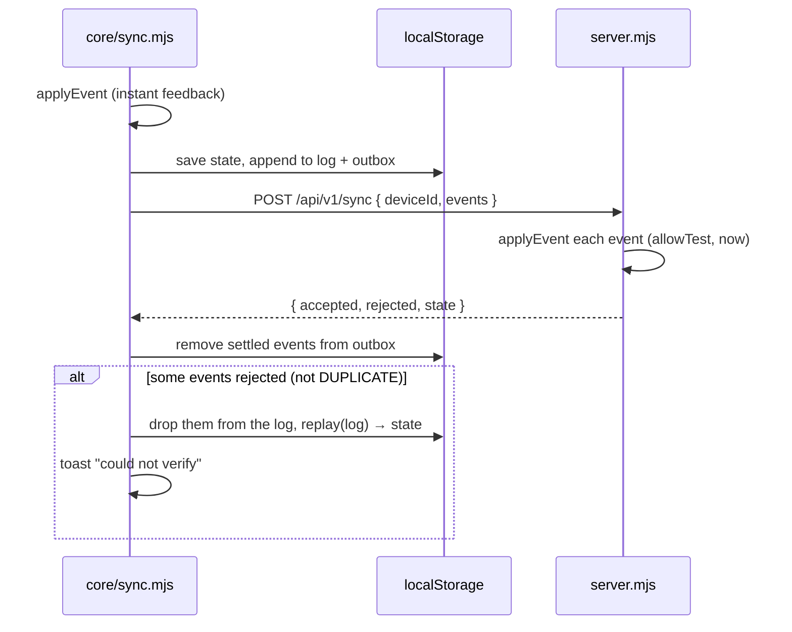

# UzQuest architecture

UzQuest is an **offline-first web app with a shared game engine and event sourcing**. The browser is where the game is played. The server keeps a verified copy of each traveller's progress, runs the partner dashboard and talks to Claude. Both sides run the same rules file.

There is no framework and no build step. The code is plain ES modules. The only server dependency is the optional `@anthropic-ai/sdk`.

For setup, gameplay and content, see [README.md](README.md). This document explains how the parts fit together and why.

## Overview



## Directory map

| Path | Role | Runs in |
|---|---|---|
| `public/shared/content.mjs` | All game content as data: cities, places, quests, rarities, offers, badges, levels, in UZ/EN/RU (Turkish and Chinese attached from `shared/lang/`) | browser + server |
| `public/shared/languages.mjs`, `public/shared/lang/` | The supported languages (uz, en, ru, tr, zh); Turkish and Chinese texts for the content, app, website, offline guide and bot | browser + server |
| `public/shared/engine.mjs` | Pure game rules: `applyEvent`, `replay`, answer checks, XP, coupons, badges, suggestions | browser + server |
| `public/app/app.mjs` | Entry point: registers the screens, wires global listeners, draws the first screen | browser |
| `public/app/core/` | `session` (state loaded from the device), `sync` (events, outbox, server sync), `router` (hash routes, `registerScreens`, `onBeforeRender`), `storage`, `ui` (DOM and text helpers), `feedback` (toasts, confetti), `location` | browser |
| `public/app/components/cards.mjs` | Cards used by more than one screen: place cards, coupon tiles, collectible cards | browser |
| `public/app/screens/` | One module per screen. `hunt.mjs` and `photos.mjs` are helpers of `place.mjs` | browser |
| `public/app/i18n.mjs` | UI strings in five languages | browser |
| `public/app/local-guide.mjs` | Offline Hamroh: keyword intents answered from local tips | browser |
| `public/sw.js` | Service worker: precaches the app shell, network-first with cache fallback | browser |
| `public/index.html`, `landing.*` | Project website with an embedded live demo | browser |
| `public/admin.html`, `admin.mjs` | Partner dashboard: metrics, funnels, voucher redemption | browser |
| `backend/src/server.mjs` | HTTP server: API routes, static files, rate limits, security headers | server |
| `backend/src/store.mjs` | SQLite store (Node's built-in `node:sqlite`): devices, events, voucher index, one-time import of the old JSON file | server |
| `backend/src/guide.mjs` | Hamroh with Claude | server |
| `scripts/build.mjs` | Copies `public/` to `dist/` (without admin) for static hosting | build |

Inside `public/app/`, imports only point downwards: `screens → components → core → shared`. Screens never import each other, with one exception: `place.mjs` uses its `hunt.mjs` and `photos.mjs` helpers, which report back through callbacks instead of importing `place.mjs`. A screen that starts something (the map, the detox timer, the GPS watch) stops it itself by registering with `onBeforeRender`. Every module must be listed twice: as `<link rel="modulepreload">` in `public/app/index.html`, so the browser fetches the whole graph in parallel instead of one import level at a time, and in `SHELL` in `public/sw.js`, so the app opens offline. `backend/test/static.test.mjs` fails if either list is missing a module or names a file that does not exist.

## Core ideas

### 1. One rules engine, two places

`engine.mjs` imports only `content.mjs` and has no I/O, so the browser and the server run exactly the same code. The phone uses it to give instant feedback while offline. The server uses it to re-check every event before accepting it. Because there is only one copy of the rules, the two sides cannot drift apart.

Keep the engine pure. Anything that touches the DOM, storage, the network or the clock (other than an event's own `at`) belongs in `app.mjs` or `server.mjs`.

### 2. Event sourcing

Progress is never edited directly. Every action becomes an immutable event:

| Event `type` | Key fields | Effect |
|---|---|---|
| `start` | `placeId` | Marks a place as started |
| `quest` | `questId` plus the proof for its type (`answer`, `text`, `code`, `order`, `hasPhoto`, `lat`/`lng`/`accuracy`, `test`) | Completes a quest; may complete the place and the city |
| `daily` | `cityId`, `dailyId` | Daily quest XP, once per Uzbekistan calendar day |
| `detox` | `startedAt` | Digital-detox XP, once per day, after `DETOX_MINUTES` |
| `reward` | `cityId` | Issues the city voucher once the city is complete |

`applyEvent(state, event, options)` returns `{ ok, state, gained, ... }` or `{ ok: false, error }`. It never mutates its input. `replay(events)` folds a list of events into a state. Coupons are unlocked as a side effect of any successful event.

Every event has a client-generated `id`, so the server can recognize a repeat and resending is always safe (idempotent). Voucher and coupon codes are derived from event ids, so the phone and the server compute the same code independently.

### 3. Offline-first sync



- The phone is usable with no network. The outbox drains whenever the server is reachable. Syncs run one at a time.
- The server is authoritative. If it rejects an event, the phone rebuilds its state from its own log without that event, so the two copies agree again.
- Installs created before the log existed have no log (`null`). They keep their state as is.
- Photos stay on the device in IndexedDB. Only `hasPhoto: true` is sent.

### Telegram accounts

Playing needs no account. Logging in with Telegram keeps progress safe and shares it across phones.

```mermaid
sequenceDiagram
  participant App as core/auth.mjs
  participant S as server (accounts.mjs)
  participant Bot as Telegram bot
  App->>S: POST /auth/telegram/start { deviceId }
  S-->>App: { token, url: t.me/<bot>?start=<token> }
  App->>Bot: traveller opens the link, taps Start
  Bot->>S: /start <token> (long polling)
  S->>Bot: "Log in on this phone?" [Yes, it's me] [No]
  Bot->>S: Yes (same Telegram user, before expiry)
  App->>S: POST /auth/telegram/status { token } (every 2 s)
  S-->>App: { session, account, state } once; device linked
```

- **Progress has one owner.** A device that is not logged in owns its own state. Once linked, the device syncs into the account's state, and every sync returns it, so each phone shows the progress of all of them. On the phone, that state plus the events not sent yet is the truth; the guest event log is no longer used.
- **Merging.** Linking a device applies its accepted events on top of the account's state. Nothing the account already has changes (a coupon code shown on another phone keeps its code), and a quest done on both phones counts once.
- **Logging out** (or a reset) gives the phone a new device id and an empty state. The old device stays linked, so its history remains part of the account.
- **Deleting the account** (Profile) removes the account, every device linked to it with their events, its codes, sessions and login attempts. A phone that later syncs with a session that no longer exists gets a 401 and starts over, so no phone keeps showing a deleted account.
- **Not synced:** the profile (name, avatar, interests). A new phone goes through onboarding before it can log in.

### 4. Content is data

Adding a city, place, quest, offer or badge means editing `content.mjs` only. The UI, the suggestions, the admin funnels and the tests all read from it. `engine.test.mjs` checks that ids are unique, answers are valid and every quest exists in all five languages; `languages.test.mjs` checks that every Turkish and Chinese entry exists, matches its English placeholders and is not stale.

### 5. Two deployment shapes

| Shape | Command | What works |
|---|---|---|
| Full | `npm start` | Everything: sync, admin dashboard, voucher redemption, Claude guide |
| Static | `npm run build` → `dist/` (GitHub Pages) | The whole game, offline-first. No sync, no admin. Hamroh uses its offline answers |

The app detects the server through `GET /api/v1/health` and degrades on its own when there is none.

## Server API

| Route | Auth | Purpose |
|---|---|---|
| `GET /api/v1/health` | — | Liveness, whether Claude is available, whether test events are allowed, the bot's username (`telegram`, or null) |
| `POST /api/v1/sync` | `deviceId`; a linked device also needs `Authorization: Bearer <session>` (401 without) | Upload events; returns accepted and rejected ids plus the owner's state (the account's, once linked) |
| `POST /api/v1/auth/telegram/start` | — | Start a login for `deviceId`: a token and its `t.me` link; 503 without a bot, 409 if already linked |
| `POST /api/v1/auth/telegram/status` | login token | `pending`, `cancelled`, `expired`, `used`, or `ok` with the session, the account and its state (handed out once) |
| `POST /api/v1/auth/logout` | session | Ends the session |
| `POST /api/v1/auth/delete` | session | Deletes the account with its devices, their events and codes, its sessions and login attempts |
| `POST /api/v1/meet/check` | — | Is this the secret word of a meet quest? Records nothing; rate-limited with sync's wrong guesses |
| `POST /api/v1/guide` | — | Ask Hamroh (Claude); returns 503 if not configured, 502 if it failed |
| `GET /api/v1/admin/overview` | `x-admin-key` | Metrics, funnels per place, offers, vouchers, recent travellers |
| `POST /api/v1/admin/redeem` | `x-admin-key` | Redeem a city voucher or partner coupon once |

Everything else is served as a static file from `public/`, with protection against path traversal. Text files of 1 KB or more are sent with brotli or gzip when the browser accepts it, and every file carries an `ETag`, so the repeated requests caused by `Cache-Control: no-cache` and the service worker's network-first fetch are answered with a body-less `304`.

### Data model (`data/uzquest.db`, SQLite)

| Table | Row | Columns |
|---|---|---|
| `devices` | One phone | `id`, `account_id` (null until logged in), `created_at`, `last_seen_at`, `lang`, `state` (JSON: `{ v: 3, xp, started, quests, places, dailies, detox, rewards, coupons }`), `redeemed` (JSON: `{ [cityId \| "coupon:<offerId>"]: timestamp }`) |
| `events` | One accepted event | `device_id`, `id`, `received_at`, `data` (JSON, known fields only) |
| `accounts` | One Telegram user | `id`, `telegram_id`, `name`, `username`, `created_at`, `state`, `redeemed` (as on `devices`) |
| `codes` | One voucher or coupon code an owner holds | `owner` (`d:<device id>` or `a:<account id>`), `key` (`cityId` or `coupon:<offerId>`), `code` (indexed) |
| `logins` | One "log in with Telegram" attempt | `token_hash`, `device_id`, `expires_at`, `status` (`pending` → `asked` → `confirmed` → `used`, or `cancelled`), the Telegram user |
| `sessions` | One logged-in device | `token_hash`, `account_id`, `device_id` |

Tokens are stored only as SHA-256 hashes. Schema changes are numbered migrations recorded in `PRAGMA user_version`, so an older database is upgraded on start.

The game state stays a JSON column because the engine owns its shape; the server never queries inside it. `codes` is rebuilt from the state whenever a device or account is saved, so redemption looks a code up instead of scanning every traveller.

The driver is synchronous, and each sync or redemption runs inside `store.transaction(...)`, so it is atomic and requests cannot interleave. A sync only reads and writes its own device, unlike the old JSON file that was rewritten whole: with 5,000 devices a sync went from about 130 ms to about 1 ms. The database runs in WAL mode. A device whose state has an older `v` loses its events and codes and starts over on its next sync.

`data/store.json`, the format before SQLite, is imported once into an empty database and then renamed to `store.json.imported`.

## Trust and security

Content and rules ship to the browser, so everything in them can be read from the bundle: quiz, riddle and timeline answers, and the treasure-hunt coordinates. The one exception is the **secret words of meet-a-local quests**. They are the strongest proof of a visit, because a partner's staff member says them on site, so they are kept on the server only. For the rest, the server's job is to limit what a cheating client can gain, not to make cheating impossible.

| Control | Where |
|---|---|
| Every event is re-validated with the shared engine | `sync()` |
| Telegram login needs a second step in the bot ("Yes, it's me"), answerable only by the Telegram user who opened the link and only before it expires (10 min). The prompt warns never to confirm a link someone sent. This stops an attacker from sending their own login link to a victim to link the victim's account to the attacker's phone | `accounts.mjs` |
| A linked device can only sync with its session; tokens are random (192-bit) and stored hashed; a session is handed out once | `server.mjs`, `store.mjs` |
| The partner dashboard lists accounts as `acct-<n>`, never by Telegram name | `overview()` |
| Secret words exist only on the server (`MEET_CODES_FILE`); the phone accepts a word provisionally and the server confirms or rejects it | `server.mjs`, `checkQuest()` |
| 10 wrong secret words per address per minute, shared by `/meet/check` and sync; beyond that words are not judged at all (`TRY_LATER`), so a right guess cannot leak | `server.mjs` |
| Daily and detox claims older than 48h are rejected (`CLAIM_EXPIRED`) | `engine.mjs`, enforced when the server passes `now` |
| Timestamps from the future are clamped to the server time | `sync()` |
| Test shortcuts (simulated GPS, skipped photo) are off when `NODE_ENV=production` unless `ALLOW_TEST_EVENTS=true` | `server.mjs`; the app hides them via `/health` |
| The dev admin key is refused in production or on a non-loopback host | startup |
| Rate limits per IP: admin failures, sync, guide, new devices | `rateLimit()` |
| Only known event fields are stored; bodies are capped at 256 KB | `cleanEvent()`, `readBody()` |
| Ambiguous voucher codes are refused instead of guessed | `redeem()` |
| All rendered text is escaped; Claude replies are set as `textContent` | `public/app/`, `admin.mjs` |

## Testing

- `backend/test/engine.test.mjs` covers the rules as pure functions: content integrity, every quest type, XP, coupons, story order, time-of-day stamps and the claim window.
- `backend/test/server.test.mjs` starts real server processes on temporary data files and covers crashes, status codes, rate limits, production settings, secret words and guessing limits, event cleaning and redemption.
- `e2e/*.test.mjs` play the web app in headless Chromium against a real server: every screen, production settings, offline use, secret words checked online and offline, and a treasure hunt driven by live GPS. Any JavaScript error in the page fails the run.

Run the first two with `npm test` and the browser tests with `npm run test:e2e`. CI runs both on every pull request and before each GitHub Pages deploy.

## Known limits and next steps

| Limit | Impact | Direction |
|---|---|---|
| SQLite in one process | One server process; queries block the event loop briefly | Fine for a pilot. For several servers, move to PostgreSQL behind the same `SqliteStore` methods |
| Quiz, riddle and timeline answers ship to the client | They can be read instead of found on site | Acceptable: they are trivia, not proof of a visit |
| Treasure-hunt GPS and photo quests are trusted | Coordinates can be spoofed and `hasPhoto` is just a flag | The server cannot prove either. Rewards that matter should depend on meet-a-local quests, which a partner confirms on site |
| Accounts are optional | A guest's progress is lost with the phone or browser data | The app offers Telegram login in Profile |
| One bot process | Long polling allows only one server using the bot token | Switch to a webhook for several servers |
| In-memory rate limits | Reset on restart, and are per process | Fine with one replica. Behind a hosting proxy, `TRUST_PROXY=1` takes the client from the last `X-Forwarded-For` entry |
| String-built UI (`innerHTML`) | Manual event wiring; escaping must not be forgotten | Revisit when moving to native apps |
